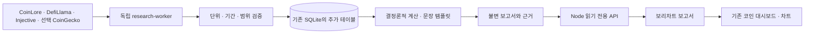

# 보리차트 정기 보고서 — Injective와 시장 데이터를 함께 읽기

문서 기준일: 2026-10-18. 기존 보리차트에 통합하는 구현 기준입니다. 실행·배포 결과는 [0.37 검증 기록](audit-37/README.md)에서 별도로 확인합니다.

## 목적과 범위

시장에서 코인을 찾고 차트로 분석하는 기존 흐름에, 같은 기준으로 계산한 일간·주간 보고서를 연결합니다. Injective의 실제 시장 활동과 전체 시장 집계를 구분해 읽을 수 있도록 합니다.

보고서는 관측값·검증한 계산·고정 문장으로 만듭니다. AI, 자연어 질문, LLM 호출, Telegram, 에이전트 SDK, AInj와 MCP는 제품에 넣지 않습니다. 추후 연결을 위한 모델·프롬프트·비용 설정도 만들지 않습니다. Codex는 개발 도구이며 운영 프로세스와 별개입니다.

| 유지 | 추가 | 제외 |
|---|---|---|
| 150개 자산·시장·차트·비교·저장 | `/reports` 목록과 보고서 상세 | 주문·서명·지갑 키 입력 |
| React·TypeScript·Node·SQLite | 독립 보고서 수집 작업자 | 별도 Python 웹 앱·새 DB |
| 기존 가격·온체인·선물 수집 | Injective 시장·선별 체결, 체인 TVL | 검증하지 않은 전체 거래량 순위 |
| 기존 브리핑·개인 자료 경로 | 고정 근거를 가진 일간·주간 보고서 | AI 답변·텔레그램·공유·내보내기 |

초기 관심 자산은 INJ·HYPE·UNI·LINK·ONDO·SEI·DYDX·AAVE·XRP·XEC·BTC·ETH·SOL입니다. 기존 자산 명부의 제공자 ID를 재사용합니다. INJ의 거래소 가격과 Injective 네트워크 내부 거래는 같은 데이터가 아닙니다.

## 화면과 사용 흐름

상단 탐색은 시장 / 비교 / 내 저장을 유지합니다. 시장과 INJ 대시보드에 짧은 보고서 링크를 둡니다. 보고서 화면과 데이터는 링크를 열 때 불러옵니다.

1. 시장 또는 INJ 대시보드에서 보고서를 엽니다.
2. 전체 시장·Injective, 일간·주간을 선택합니다.
3. 기간과 주요 변화 최대 3개를 읽습니다.
4. 같은 정의의 지표 표를 확인하고 관련 차트로 이동합니다.
5. 필요한 경우 근거를 펼쳐 원천과 계산 범위를 확인합니다.

수집 시각·재시도·작업 과정은 본문에 나열하지 않습니다. 값의 단위와 보고 기간, 자료가 불완전해 해석이 제한되는 부분은 숨기지 않습니다. 새로운 보고서가 없으면 과거 보고서를 오늘 보고서처럼 바꾸지 않습니다. 숫자가 없으면 0 대신 미제공 상태를 사용합니다.

흰색·청록·보리, 저장된 다크 테마를 유지합니다. 보고서마다 장식 카드나 긴 환영문을 추가하지 않습니다. 화면에는 고정 문장과 검증된 숫자만 표시합니다. 모바일 표는 필요한 열을 우선하고 키보드로 필터·근거·관련 차트를 사용할 수 있게 합니다.

## 기존 코드와 통합

| 경로 | 책임 |
|---|---|
| `shared/report-types.ts` | 보고서·근거·조회 계약 |
| `worker/onchain/` | 원천 정규화·저장·계산·보고서 발행·읽기 조회 |
| `server/research-worker.mjs` | 독립 일정·잠금·재시도·실행 상태 |
| `migrations/0010_research_reports.sql` | 기존 테이블을 변경하지 않는 추가 스키마 |
| `src/ReportsPage.tsx` | 목록·상세·접힌 근거·필터 |
| `deploy/vps/research_release.py` | 추가 스키마와 독립 작업자를 검증하는 배포 경로 |

기존 `/research`, `/api/v1/research`, `/api/v1/research/public`, `/api/v1/briefings`는 의미와 자료를 보존합니다. 개인 자료와 기존 `research` 경로를 새 공개 보고서의 저장소로 재사용하지 않습니다. 기존 저장 키·작업공간 버전 1·2·주석·이미지를 변경하지 않습니다.

## 데이터 계약

| 원천 | 사용 범위 | 공개 전 확인 |
|---|---|---|
| CoinLore | 전체 시장 집계·명부의 관심 토큰 | 통화·시각·원천의 집계 범위 |
| DefiLlama | Injective·Ethereum·Solana TVL, 확인한 DEX 집계 | 체인과 앱 구분·중복 귀속·유량 정의 |
| Injective 공식 TS SDK | 활성 시장·메타데이터·선별 체결·호가 | 시장 ID·네트워크·decimals·중복·조회 구간 |
| Injective Chronos | 시장 요약·봉 이력 | 응답 형태·실제 시간 범위·단위 |
| CoinGecko | 선택 키가 있을 때 관심 13개 시총·FDV | 제공자 ID·동일 응답·출처 및 이용 조건 |

CoinGecko가 꺼져 있거나 실패해도 기존 시세와 다른 보고서 입력은 동작합니다. CoinLore의 공급량으로 FDV를 임의 생성하지 않습니다. 공급자가 보고한 FDV와 유통 시가총액을 같은 시점·통화로 비교합니다.

Injective 첫 관찰 대상은 검증한 INJ·BTC·ETH 관련 시장을 우선해 최대 10개(현물 5개·파생 5개)입니다. 시장 ID로 선택하며 심볼의 첫 일치값을 사용하지 않습니다. 이 범위의 표본을 Injective 전체 거래대금이나 앱별 점유율로 표현하지 않습니다.

Chain-format 현물은 수량을 `10^baseDecimals`로 나누고 가격에 `10^(baseDecimals−quoteDecimals)`를 곱합니다. 파생은 별도 반환 계약을 확인합니다. Chronos에 같은 변환을 일괄 적용하지 않습니다. 소수 문자열은 Decimal로 계산하고 표시할 때만 반올림합니다. 원문 전체의 주소·주문 정보는 공개 근거에 넣지 않습니다.

Chronos의 단위 미확정 volume은 순위 계산에서 제외합니다. 24개 봉을 24시간으로 간주하지 않습니다. 거래 양면·페이지 중복·시간창 끝을 확인하기 전에는 완전한 거래량이라고 표시하지 않습니다. USDT·USDC를 근거 없이 정확한 USD로 바꾸지 않습니다.

## 계산과 근거

- 토큰·체인·프로토콜·거래 시장을 별도 식별합니다. 현물과 파생을 합산하지 않습니다.
- TVL의 USD 증감을 자금 순유입으로 표현하지 않습니다. 체인 TVL과 소속 앱 TVL을 다시 더하지 않습니다.
- 스냅샷 변화는 일치하는 기준 시점끼리 비교합니다. 유량은 서로 겹치지 않는 완료 구간을 합산합니다.
- 주간 유량의 전주 대비에는 보통 14일의 완결된 자료가 필요합니다. 3일의 자료로 주간 변화율을 만들지 않습니다.
- 반복 저장한 rolling 24h 거래량을 더해 일간·주간 거래량을 만들지 않습니다.
- 비교값이 0이면 절대 차이와 신규 발생을 표시하고 무한대 변화율을 만들지 않습니다.
- `dataAsOf`와 `fetchedAt`은 별도로 보존합니다. 조회 시각으로 실제 관측 시각을 바꾸지 않습니다.
- 각 표시값은 저장된 evidence ID를 참조합니다. 근거 ID·내용 해시·방법 버전·템플릿 버전을 보고서와 함께 고정합니다.

발행한 내용과 근거는 덮어쓰지 않습니다. 정정이 필요하면 새 revision을 만들고 이전 보고서와 연결합니다. 목록의 최신 정정본과 과거 주소의 원문을 구분합니다. 같은 입력과 버전은 같은 결과를 내야 합니다.

## 일정과 운영

일간은 매일 **09:10 KST**, 주간은 월요일 **09:20 KST**입니다. 같은 시간의 전체 시장·Injective 보고서를 순차 처리합니다. 첨부 초안의 다른 시간은 이 일정으로 대체합니다.

보고 기간은 직전 완료 UTC 하루와 직전 완료 UTC 주입니다. KST 발행 시각과 데이터의 UTC 집계 구간을 혼동하지 않습니다. 자료가 부족하면 확인된 범위만 담고 부족한 비교는 생략합니다.

보고서 작업자는 기존 이미지·SQLite를 사용하되 별도 프로세스·실행 잠금·상태를 가집니다. 기존 시세·배경·최근·분석 4개 수집 lane과 180초 상태 판정을 변경하지 않습니다. 공개 조회는 DB를 읽기만 하며 원천 요청·수집·발행을 시작하지 않습니다.

기본 자원 한도는 CPU 0.5·메모리 512MiB입니다. 제공자별 동시 요청은 최대 2개로 제한하고 timeout·Retry-After·지수 대기·체크포인트를 적용합니다. 8GiB 공간 보호를 유지하고 기존 데이터나 다른 서비스를 삭제하지 않습니다. 비밀키는 작업자 환경에만 전달합니다.

## 읽기 API

| API | 조회 |
|---|---|
| `GET /api/v1/reports` | `type`, `scope`, `cursor`, `limit` 목록 |
| `GET /api/v1/reports/latest` | 선택 범위의 최신 발행 요약 |
| `GET /api/v1/reports/:reportId` | 고정 본문·근거·정정 연결 |
| `GET /api/v1/onchain/coverage` | 선택 범위의 보유 이력·원천 상태 |
| `GET /api/v1/onchain/markets` | 검증한 Injective 시장 목록 |
| `GET /api/v1/onchain/series` | 허용한 대상·지표·기간의 저장 관측 |

입력 길이·페이지·결과 수·조회 기간을 제한합니다. 임의 SQL·URL·셸을 입력으로 받지 않습니다. 인증정보·내부 경로·원문 개인 자료를 응답과 로그에 포함하지 않습니다.

## 검증과 배포

1. 단위·소수점·0/null·시간창·중복·부분 실패·근거 불변성·일정 재실행을 검사합니다.
2. 새 API의 GET에서 원천 호출과 DB 쓰기가 없는지 검사합니다. 잘못된 필터와 없는 보고서가 안전하게 끝나는지 확인합니다.
3. 목록 → 상세 → 근거 → 관련 차트 → 뒤로 가기를 Chromium·WebKit·모바일·키보드·axe로 확인합니다.
4. 원격 PR·main CI가 통과한 동일 빌드를 사용합니다.
5. 새 백업의 독립 복원 후 0010을 별도 복사본에 적용하고 기존 테이블의 행·내용·스키마를 대조합니다.
6. 기존 0001~0009 해시를 유지한 추가 마이그레이션만 적용합니다. 새 API·웹·보고서 작업자만 배포합니다.
7. Pages·VPS의 빌드 식별·실제 원천·보고서·기존 핵심 시세를 확인합니다. 롤백은 API·작업자를 되돌리고 추가 데이터를 삭제하지 않습니다.

일정의 가상 시각 검사와 실제 예약 실행을 구분합니다. 첫 주간 실제 예약이 아직 지나지 않았다면 완료로 기록하지 않습니다. 48시간 대기를 추가하지 않습니다. 사람의 사용성·실물 휴대폰·Safari·VoiceOver는 실제 수행한 범위만 보고합니다.

## 공식 참고 자료

- [Injective TypeScript SDK](https://github.com/InjectiveLabs/injective-ts), [시장 조회](https://docs.injective.network/developers-native/query-indexer/markets)
- [Injective API](https://api.injective.exchange/)
- [CoinLore API](https://www.coinlore.com/cryptocurrency-data-api)
- [DefiLlama 무료 API](https://api-docs.defillama.com/llms-free.txt), [지표 정의](https://docs.llama.fi/analysts/data-definitions)
- [CoinGecko 토큰 지표](https://docs.coingecko.com/demo/reference/coins-markets), [호출 제한](https://docs.coingecko.com/docs/errors-and-rate-limits)

패키지 설치·실제 응답·원천별 확인 결과는 [SOURCES_STATUS](SOURCES_STATUS.md)에 남깁니다. 문서와 공개 조회 1회는 장기 완결성이나 이용 권한 확대의 근거가 아닙니다.
