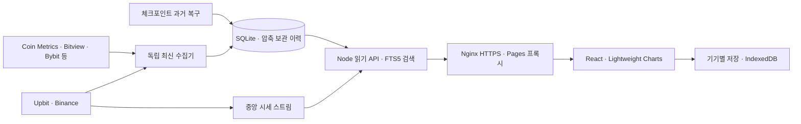

# 보리차트 제품 기준

기준일: 2026-10-17. 현재 제품과 0.36의 기준 문서입니다. 이전 RELEASE 문서는 해당 시점의 이력이며 현재 구현·운영 완료를 대신하지 않습니다. 실행 결과는 [0.36 검증 기록](audit-36/README.md)에 연결합니다.

## 목적과 사용자 흐름

관심 있는 코인의 장기 가격과 사이클을 여러 차트로 이어 읽는 한국어 분석 도구입니다. 코인을 찾고, 가격·가치평가·보유자·추세를 확인하고, BTC 기준으로 비교한 뒤 분석을 다시 여는 흐름에 집중합니다. 주문·계좌 연결·AI 매수 판단은 제공하지 않습니다.

1. 시장에서 검색·관심목록·테마를 이용해 코인을 선택합니다.
2. 코인 대시보드에서 지원되는 차트를 순서대로 읽습니다. PC 왼쪽 목록과 모바일 선택창으로 코인을 바꿉니다.
3. 필요한 차트만 크게 열어 날짜·확대·주석 등 세부 조작을 사용합니다.
4. 대시보드의 BTC 가격 비율을 읽고, 별도 성과 비교와 같은 지표 비교로 이동합니다. BTC의 기본 비교 상대는 ETH입니다.
5. 차트 구성·기간·확대·읽던 위치를 저장하고 내 저장에서 다시 엽니다.

일반 코인 선택은 `/coins/:asset` 대시보드로 연결합니다. 지표를 명시한 검색 결과와 기존 `metric` URL은 해당 지표의 집중 화면을 유지합니다. 시장 홈은 모든 기기에서 동일합니다.

## 화면과 정보 위계

| 화면 | 중심 행동 | 보조 기능 |
|---|---|---|
| 시장 | 150개 코인 탐색·관심목록 | 31개 테마와 가격·거래량 매트릭스 |
| 코인 대시보드 | 차트를 연속해서 읽기 | 차트별 확대·읽는 법·구성 선택 |
| 차트 집중 화면 | 선택 차트의 기간·날짜·추세 확인 | 주석·패턴·보조 지표 |
| 비교 | 가격 성과 또는 같은 지표 비교 | 대시보드의 BTC 가격 비율과 구분, 동일 통화·원천·공통 날짜 확인 |
| 내 저장 | 저장한 분석 다시 열기 | 기기 내 개인 자료·백업·복원 |
| 지표 사전 | 정의와 예시 이해 | 실제 해당 코인 차트로 이동 |

기본 차트는 가격 → 슈퍼트렌드 → MVRV·레인보우·실현가격·MVRV Z → NUPL·SOPR·보유자 → 해시레이트·활성 주소 → BTC 가격 비율 순서입니다. 지원하지 않는 차트는 기본 구성에 넣지 않습니다. 거래 수·리본·볼린저밴드·계절성은 선택해서 추가합니다.

보리차트 이름과 기존 시바견 보리를 유지합니다. 흰색·청록, 빨강·파랑 등락색을 사용하고 저장된 다크 설정을 보존합니다. 행·차트·구분선으로 구성하며 홍보 문구, 장식 그라데이션, 움직이는 버튼을 넣지 않습니다. 공개 화면에 수집 과정·운영 기록·공유·내보내기·날짜 수치표를 노출하지 않습니다. 지표의 값·단위와 필요한 지연 표시는 남깁니다.

## 데이터 범위와 구분

다음 수치는 명부의 지원 범위이며 모든 원천의 현재 정상 상태를 뜻하지 않습니다.

| 범위 | 현재 정의 |
|---|---|
| 종목 | 고정 명부 150개, 거래소 조합 241개 |
| 가격 | Upbit KRW 103개·Binance USDT 138개 실제 OHLC, 일·주·월 전체 확보 이력, 시간봉 최근 90일 |
| 장기 종가 | Coin Metrics USD 참조가격 143개 |
| MVRV | Coin Metrics 실제 지원 33개 |
| 네트워크 활동 | 지원 명부 34개, 지표별 교집합 사용 |
| 해시레이트 | BTC·DOGE·BCH·ETC·ZEC·LTC·DASH 7개 |
| BTC 추가 지표 | Bitview의 실현가격·SOPR·STH/LTH MVRV·STH 실현가격·NUPL, 원천 시가총액으로 계산한 MVRV Z |
| 선물 | 기존 Bybit USDT 무기한 136개, 지원 계약·관측 주기를 구분 |

장기 가격과 자체 레인보우는 USD 종가를 우선합니다. 실제 OHLC를 요구하는 슈퍼트렌드에는 거래소 캔들을 사용하고 KRW·USDT를 명시합니다. USD 종가로 고가·저가를 만들거나 USDT를 USD로 바꾸어 표기하지 않습니다.

위치 밴드는 표시일 앞의 연속 730일을 요구합니다. 자체 레인보우는 고정 원천 기준일과 이전 유효 일별 관측 730개부터 계산합니다. 결측을 보간하거나 미래 자료를 과거 계산에 사용하지 않습니다. 계산 준비기간 때문에 가격 자체를 지우지 않습니다.

MVRV에서 유도한 실현가격·NUPL은 독립적인 세 가지 검증 근거가 아닙니다. NUPL은 순미실현손익이며 손실만의 비율이 아닙니다. STH/LTH MVRV와 LTH SOPR, 공급량 HODL Waves와 실현가치 가중 HODL Waves를 서로 대체하지 않습니다. [CryptoDan 참고 차트 20개 대조](audit-36/reference-charts.md).

## 구조와 운영

- 공통 가격 입력은 대시보드에서 공유하고, 추가 입력과 차트는 화면 가까이 왔을 때 불러옵니다. 자산·지표·원천별 요청과 확대 상태를 분리합니다.
- 실제 체결 시각의 300초 기준을 유지합니다. 스트림 연결, 분 단위 확인, 일별 온체인 관측은 별개입니다.
- 정상 수집과 과거 복구를 분리합니다. 일반 선물 과거 예산은 1일 10,000후보이며 승인된 일회 작업만 명시적 만료·예산으로 확대합니다.
- 디스크 여유 8GiB를 보호하고 사용자 자료·다른 프로젝트를 삭제하지 않습니다. 동일 VPS 백업과 별도 파일 복원 검증은 서버 전체 재해 복구를 뜻하지 않습니다.
- 기존 React·Base UI·Lightweight Charts·Node·SQLite·SSE·FTS5를 유지합니다. 새 DB·벡터 검색·GraphRAG·관계 그래프 확대·X 수집은 이번 범위에서 하지 않습니다.

## 호환·검증·출시

기존 URL·개인 설정 키·작업공간 버전 1·2·개인 자료·주석은 보존합니다. 버전 2에 선택적인 대시보드 차트·범위·읽던 위치만 추가합니다. 새 설정이 없는 기존 저장은 원래 의미로 엽니다.

타입·계산·복원·브라우저·키보드·터치 자동 검사와 실데이터 흐름을 따로 기록합니다. 원격 main CI를 통과한 빌드만 새 백업·독립 복원 후 변경된 서비스에 배포합니다. Pages와 VPS의 공개 자산·실행 식별자를 대조합니다. 절차는 [배포 안내](../DEPLOYMENT.md)를 따릅니다.

48시간 대기는 완료 조건이 아닙니다. 실물 휴대폰·Apple Safari·VoiceOver·사람 대상 사용성은 실제 수행한 범위만 완료로 기록합니다. 코드·자동 검사·운영 반영·데이터 복구·성능을 하나의 완료 문구로 합치지 않습니다.
